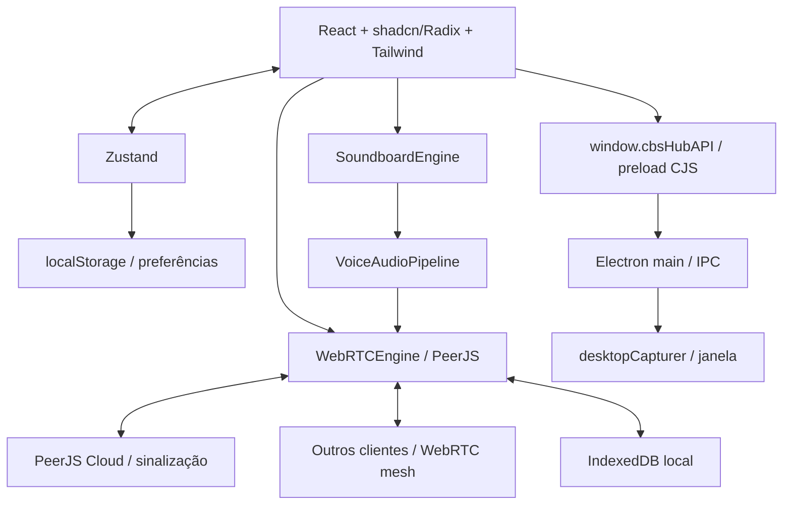

# Arquitetura atual

Data: 05/11/2026 (America/Sao_Paulo). Responsável: Codex/OpenAI.
Branch: `audit/cbshub-v2-2026-11-05`. Base auditada: `5deab40aa1629a975dc72588b658569b21494c23`.

## Componentes e fronteiras

Não há servidor próprio de aplicação, banco remoto ou API autenticada no repositório. O PeerJS Cloud negocia conexões; mídia e mensagens viajam entre peers. Sala é um slug usado para derivar IDs, sem autorização central. O beacon pertence a um cliente e responde diretório; uma eleição tenta substituí-lo quando alguém sai.

## Fluxos e contratos a preservar

- Inicialização: `src/main.tsx` monta App em StrictMode; App pede microfone e entra na sala salva. `joinRoom` limpa sessão, carrega histórico e sons, cria Peer, publica participante e tenta beacon.
- Texto: compositor → `sendChatMessage` → persistência local → Zustand → broadcast DataConnection. Recepção persiste/adiciona. Sync usa roomId, timestamps e knownIds; reações usam operações toggle.
- Voz: `joinVoiceCall` prepara microfone, marca presença em voz e cria MediaConnections com pares em voz. `leaveVoiceCall` pretende preservar chat. Voz, webcam e tela possuem metadata channel.
- Captura: renderer → preload.invoke → main configura source; getDisplayMedia é atendido pelo main com desktopCapturer. `getDesktopSources` retorna thumbnails e IDs. Fluxo depende da ponte Electron.
- Áudio: mic → high-pass 80Hz → low-pass 14kHz → gate AudioWorklet → compressor → ganho → analyser → mute exclusivo do mic → MediaStreamDestination. Soundboard entra diretamente no destino após filtros/gate. Manter essa separação: mutar track de saída também cortaria efeitos.
- Reprodução remota atual: MediaStream em HTMLAudioElement, volume limitado a 1, saída via setSinkId; VAD usa outro AudioContext. Campos GainNode da sessão ainda existem, mas não fornecem boost na implementação atual.
- Soundboard: 8 presets sintetizados ou Blob decodificado com cache, volume do clip × volume master; retorno local e, em voz, entrada no pipeline. Eventos de rede enviam metadados visuais, não arquivos de áudio. Clipes customizados ficam no dispositivo de origem; som viaja na stream de voz.

## Estado e persistência

`useHubStore` separa preferências serializáveis e sessão. `partialize` persiste clientId, sala/recentes, nickname/cor, configurações de áudio/vídeo, volumes por clientId, volume Soundboard e altura do palco. Participantes/streams/messages em memória não são serializados por esse middleware.

IndexedDB `cbshub_local_db` v1:

| Store | Chave/índice | Conteúdo |
| --- | --- | --- |
| messages | id; by_room_time = [roomId, createdAt] | ChatMessage, reações e metadados de som; retenção pretendida de 500/sala |
| soundboard_clips | id | Nome/emoji/volume/favorito/preset ou Blob até 5 MiB |

Fallback em memória permite uso sem IndexedDB, mas perde dados ao reiniciar. Erros de algumas transações são silenciados: sucesso visual não garante gravação. Sem migration remota, contas ou compartilhamento de banco entre pessoas. Dois perfis de navegador isolados são necessários para simular clientIds distintos; duas abas do mesmo perfil compartilham localStorage.

## Build e execução

Vite 5 compila React/Tailwind 4; plugin Electron compila `dist-electron/main.js` e `preload.cjs`. `npm run build` executa tsc primeiro. electron-builder empacota dist/dist-electron; Windows NSIS/portable configurados. `npm run dev` inicia Electron automaticamente. No cloud sem display, helper externo serve renderer e Electron headless é iniciado separadamente; HMR cobre renderer, main/preload exigem rebuild/restart.

Defeito conhecido: merge de formatos do preload gera ES+CJS no mesmo caminho. Ver K01. Builds não garantem IPC válido sem execução.

## Limites para mudanças futuras

Preservar contratos de `src/types/cbshub.d.ts`, chaves do armazenamento, canais IPC, signaling e separação sala/voz. Uma alteração de layout não deve reconfigurar engine ou reiniciar mídia. Migrations de dados e alterações de protocolo exigem plano de compatibilidade e testes entre versões. Ver K02–K15 antes de interpretar esta arquitetura como garantia de correção.

## Camada visual após REDESIGN-001

WorkspaceRail + LeftSidebar + RoomTopBar compõem a navegação; MembersPanel é opcional. Sheet usa Radix Dialog existente. ResizeHandle controla somente a largura; useWorkspaceLayout persiste preferências em chave separada sem mudar o store de comunicação. Motores, tipos e IPC preservados. Design system em DESIGN_SYSTEM.md.

## Atualização — STUDIO-001 — 05/11/2026

StudioProvider envolve App; rascunho/salvo separados evitam remontar engines. theme.ts contém esquema restrito e presets; StudioDialog usa shadcn/Radix existentes; aplicação por allowlist de variáveis CSS. useWorkspaceLayout usa o provider visual. Persistência local com biblioteca; JSON v1 transferível. Ver STUDIO.md.

## Atualização — PROFILE-001 — 05/11/2026

ProfileProvider envolve App; repository local vincula perfil ao clientId e mantém bloqueios. Modelo UserProfile privado e PublicProfile separado. profile_update aditivo sobre DataConnection, associado à sessão e excluído do diretório/state_sync. Gates de mídia/reação/bloqueio ficam no motor. Sem backend ou mudança de autenticação. Ver PROFILES.

## Atualização — CHAT-002 — 05/11/2026

ChatPanel/MessageRow/SafeMarkdown substituem somente a camada de chat anterior. ChatLedger serializa operações no banco cbshub_chat_ledger; storageDb continua com mensagens/clips. Protocolo aditivo chat_operation/chat_operations_sync/chat_ack; histórico/mutação filtrados por sala/sessão/autoria local. Janela DOM de 100 e retenção 500. Ver CHAT_2.

## Atualização — MEDIA-001 — 05/11/2026

mediaState guarda apenas estado transitório de captura/erro/reconexão e qualidade por peer. PeerMediaSession separa webcamCall/screenCall recebidos de outgoingWebcam/outgoingScreen enviados; voiceCall permanece bidirecional. Tokens de geração invalidam capturas/salas antigas. PeerJS é reaproveitado no retry; transportes de chat e ledger não foram substituídos. Soundboard mantém retorno local via GainNode por contexto e injeção pós-gate; setSinkId condicionado à capacidade do runtime. SoundboardClip acrescenta category/order opcionais; banco/chaves existentes preservados. soundPreferences compartilha cbshub-chat-sounds entre painéis. Detalhes em MEDIA_EXPERIENCE.

## STABILIZE-001 — 05/11/2026

Preload usa build Rollup CJS único com lib:false, mantendo seis métodos da API. Main valida origem/frame/argumentos de IPC, bloqueia navegação externa e usa sandbox de renderer. Captura exige fonte selecionada e não usa fallback automático para a primeira tela. Journal agrupa operações por append linear, sem mudar banco/protocolo. Servidor de testes e runner agora estão versionados em scripts/. Ver STABILIZATION.

## SECURITY-002 — 05/11/2026

SECURITY-002 preserva arquitetura local/P2P. Acrescenta CSP no HTML de produção, política explícita de capacidades Electron e validador allowlist de presença. Atualiza ferramentas mantendo UI e motores. BACKEND_PROPOSAL descreve arquitetura futura para revisão, não implementação atual.

## WORKSPACE-3 — 05/11/2026

callDiagnostics armazena no máximo 200 eventos sanitizados em memória. CallDiagnosticsPanel exporta somente estatísticas e estados permitidos. Reconexão reutiliza PeerMediaSession ao substituir DataConnection, com guards por conexão/geração e retries limitados; não existe backend novo. voicePreferences guarda somente PTT/tecla em chave local separada; hook de foco controla ganho no pipeline existente. MicrophoneTest tem captura local independente, explícita e com cleanup. Favoritos locais vivem na sidebar; chat/viewState coordena pesquisa/fixadas/atividades por sala e densidade existente. Ver VOICE_RECOVERY e WORKSPACE_3_STATUS; descrições antigas de Vite/preload/backend são históricas, versões atuais em package.json e correções em SECURITY_UPDATE.

## DESKTOP-004 — 05/11/2026

Electron mantém uma instância por userData, Tray/close-to-background e getDesktopState validado no preload; headless minimiza e evita GTK sem display. settingsNavigation coordena abas; Studio/Profile reutilizam conteúdo embutido sem reiniciar motores. MicrophoneLevelMeter isola updates; header/settings usam seletores rasos. callGrid/useElementSize calculam cards pela área. AnimatedLogo/ConnectionScreen usam a identidade oficial e estados reais de inicialização/reconexão. audioTrim gera WAV restrito e preserva originalAudioBlob no mesmo armazenamento local. StreamTelemetry ganhou origem/direção/enlace e flags de medição; observador acompanha foco, gerações descartam respostas antigas e números desconhecidos não são inventados. Modelo de temas/JSON continua v1; stack/dependências/IPC antigos preservados com getter aditivo. Ver DESKTOP_REFINEMENT para contratos e limites.

## HOTFIX-005 — recuperação e desktop — 06/11/2026 UTC

A malha PeerJS permanece existente. Recuperação agora distingue sinalização, descoberta com ACK e mídia com avanço de RTP; clientIds estáveis mantêm os participantes esperados mesmo se o peerId for reconstruído. Consultas do beacon têm prazo e guards por geração/identidade. Estatísticas assíncronas antigas são descartadas por epoch da recuperação. UI consome fases/quality.flowing; não infere internet remota de RTT local. A origem de sinalização e qualidade de mídia continuam conceitos separados.

BackgroundNotice isola a confirmação única de execução em segundo plano; main persiste a preferência e valida tray-state. Sem acesso livre do renderer a IPC/arquivos. Configurações usam flags efêmeras de rascunho e editores embutidos preservados entre abas; salvar/cancelar permanece nos providers. Boot-theme.js aceita só HEX e modo do armazenamento já existente. SoundboardClip recebe intervalo aditivo sobre originalAudioBlob; bancos e protocolo de áudio não foram substituídos. Referência: HOTFIX_STABILITY.

## HOTFIX-006 — apresentação — 06/11/2026 UTC
Preferências locais de identidade em src/chat/viewState.ts usam JSON v1 aditivo com dois booleanos; não mudam banco/protocolo nem identidade do autor. MessageRow aplica avatar opcional no modo confortável e cor HEX com contraste >=4,5 contra fundo de mensagens, com fallback de tema. LocalConnectionBadge consome sinalização/presença locais; quality[peerId] permanece medição remota do enlace. Spotlight reutiliza useElementSize/callGrid; CallControls compact abre o dock existente via Popover. Logo usa keyframes distintos com janela comum totalmente revelada de 46% a 60% em 2,6 s (364 ms). Sem alteração do motor, IPC, backend, formato de temas ou assets.

## Incremento DESKTOP-007 — rc.6
Notificação renderer → preload notifyNative → IPC cbs:notify com allowedSender/schema → Electron Notification. Ativação retorna apenas ID, consumido uma vez após revalidar sessão/sala/participante. Identificação de voz é por presença na sala; sem novo backend. Efeitos são decodificados em AudioContext separado e enviados pelo mixer existente, com orçamento de cache/concorrência. O transporte e a arquitetura P2P permanecem. Ver DESKTOP_NATIVE.

## AUDIO-008 — captura não determina participação
Microfone e efeitos somam em proteção de pico antes do MediaStreamDestination. Gate continua exclusivo do microfone; mute não corta efeitos. Interrupção da captura tenta setupLocalMicrophone/replaceTrack dentro da sessão existente, sem leaveVoiceCall. Orçamento de uma recuperação por 10 s e gerações existentes impedem loops/ressurreição após sair. Falha do worklet desconecta somente o gate. Ver AUDIO_PEAK_STABILITY.
