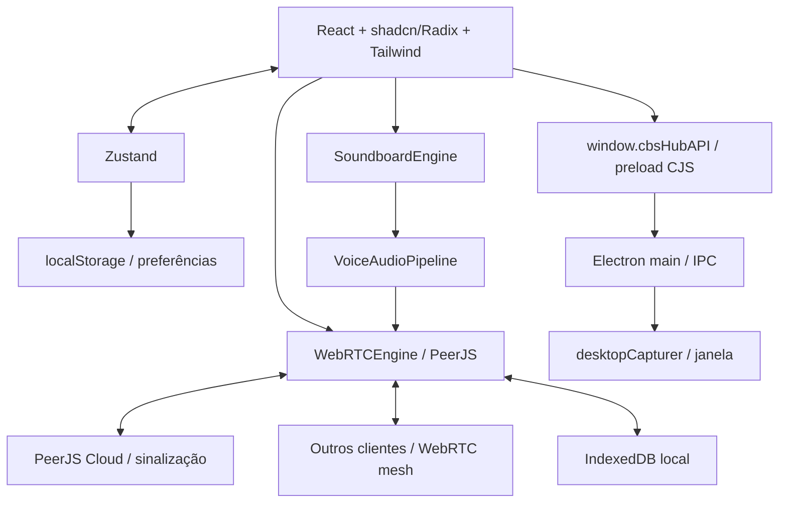

# Arquitetura atual

Data: 05/11/2026 (America/Sao_Paulo). Responsável: Codex/OpenAI.
Branch: `audit/cbshub-v2-2026-11-05`. Base auditada: `5deab40aa1629a975dc72588b658569b21494c23`.

## Componentes e fronteiras

Não há servidor próprio de aplicação, banco remoto ou API autenticada no repositório. O PeerJS Cloud negocia conexões; mídia e mensagens viajam entre peers. Sala é um slug usado para derivar IDs, sem autorização central. O beacon pertence a um cliente e responde diretório; uma eleição tenta substituí-lo quando alguém sai.

## Fluxos e contratos a preservar

- Inicialização: `src/main.tsx` monta App em StrictMode; App pede microfone e entra na sala salva. `joinRoom` limpa sessão, carrega histórico e sons, cria Peer, publica participante e tenta beacon.
- Texto: compositor → `sendChatMessage` → persistência local → Zustand → broadcast DataConnection. Recepção persiste/adiciona. Sync usa roomId, timestamps e knownIds; reações usam operações toggle.
- Voz: `joinVoiceCall` prepara microfone, marca presença em voz e cria MediaConnections com pares em voz. `leaveVoiceCall` pretende preservar chat. Voz, webcam e tela possuem metadata channel.
- Captura: renderer → preload.invoke → main configura source; getDisplayMedia é atendido pelo main com desktopCapturer. `getDesktopSources` retorna thumbnails e IDs. Fluxo depende da ponte Electron.
- Áudio: mic → high-pass 80Hz → low-pass 14kHz → gate AudioWorklet → compressor → ganho → analyser → mute exclusivo do mic → MediaStreamDestination. Soundboard entra diretamente no destino após filtros/gate. Manter essa separação: mutar track de saída também cortaria efeitos.
- Reprodução remota atual: MediaStream em HTMLAudioElement, volume limitado a 1, saída via setSinkId; VAD usa outro AudioContext. Campos GainNode da sessão ainda existem, mas não fornecem boost na implementação atual.
- Soundboard: 8 presets sintetizados ou Blob decodificado com cache, volume do clip × volume master; retorno local e, em voz, entrada no pipeline. Eventos de rede enviam metadados visuais, não arquivos de áudio. Clipes customizados ficam no dispositivo de origem; som viaja na stream de voz.

## Estado e persistência

`useHubStore` separa preferências serializáveis e sessão. `partialize` persiste clientId, sala/recentes, nickname/cor, configurações de áudio/vídeo, volumes por clientId, volume Soundboard e altura do palco. Participantes/streams/messages em memória não são serializados por esse middleware.

IndexedDB `cbshub_local_db` v1:

| Store | Chave/índice | Conteúdo |
| --- | --- | --- |
| messages | id; by_room_time = [roomId, createdAt] | ChatMessage, reações e metadados de som; retenção pretendida de 500/sala |
| soundboard_clips | id | Nome/emoji/volume/favorito/preset ou Blob até 5 MiB |

Fallback em memória permite uso sem IndexedDB, mas perde dados ao reiniciar. Erros de algumas transações são silenciados: sucesso visual não garante gravação. Sem migration remota, contas ou compartilhamento de banco entre pessoas. Dois perfis de navegador isolados são necessários para simular clientIds distintos; duas abas do mesmo perfil compartilham localStorage.

## Build e execução

Vite 5 compila React/Tailwind 4; plugin Electron compila `dist-electron/main.js` e `preload.cjs`. `npm run build` executa tsc primeiro. electron-builder empacota dist/dist-electron; Windows NSIS/portable configurados. `npm run dev` inicia Electron automaticamente. No cloud sem display, helper externo serve renderer e Electron headless é iniciado separadamente; HMR cobre renderer, main/preload exigem rebuild/restart.

Defeito conhecido: merge de formatos do preload gera ES+CJS no mesmo caminho. Ver K01. Builds não garantem IPC válido sem execução.

## Limites para mudanças futuras

Preservar contratos de `src/types/cbshub.d.ts`, chaves do armazenamento, canais IPC, signaling e separação sala/voz. Uma alteração de layout não deve reconfigurar engine ou reiniciar mídia. Migrations de dados e alterações de protocolo exigem plano de compatibilidade e testes entre versões. Ver K02–K15 antes de interpretar esta arquitetura como garantia de correção.

## Camada visual após REDESIGN-001

WorkspaceRail + LeftSidebar + RoomTopBar compõem a navegação; MembersPanel é opcional. Sheet usa Radix Dialog existente. ResizeHandle controla somente a largura; useWorkspaceLayout persiste preferências em chave separada sem mudar o store de comunicação. Motores, tipos e IPC preservados. Design system em DESIGN_SYSTEM.md.

## Atualização — STUDIO-001 — 05/11/2026

StudioProvider envolve App; rascunho/salvo separados evitam remontar engines. theme.ts contém esquema restrito e presets; StudioDialog usa shadcn/Radix existentes; aplicação por allowlist de variáveis CSS. useWorkspaceLayout usa o provider visual. Persistência local com biblioteca; JSON v1 transferível. Ver STUDIO.md.

## Atualização — PROFILE-001 — 05/11/2026

ProfileProvider envolve App; repository local vincula perfil ao clientId e mantém bloqueios. Modelo UserProfile privado e PublicProfile separado. profile_update aditivo sobre DataConnection, associado à sessão e excluído do diretório/state_sync. Gates de mídia/reação/bloqueio ficam no motor. Sem backend ou mudança de autenticação. Ver PROFILES.md.
